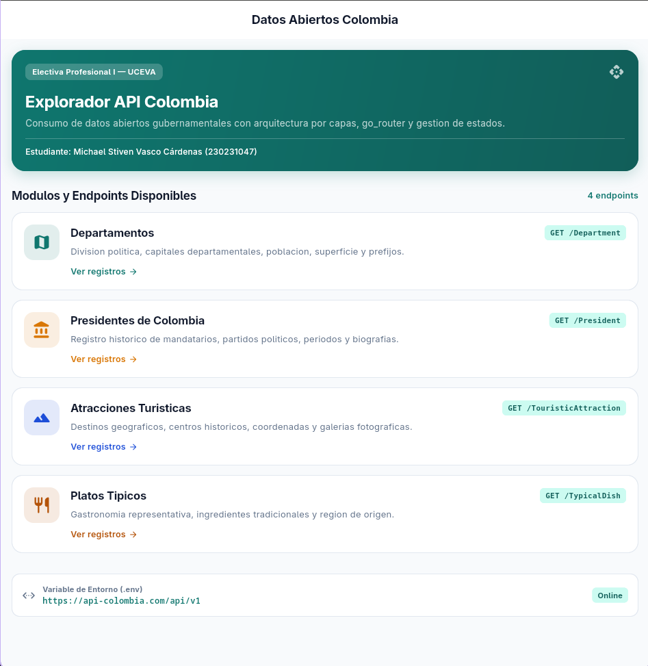
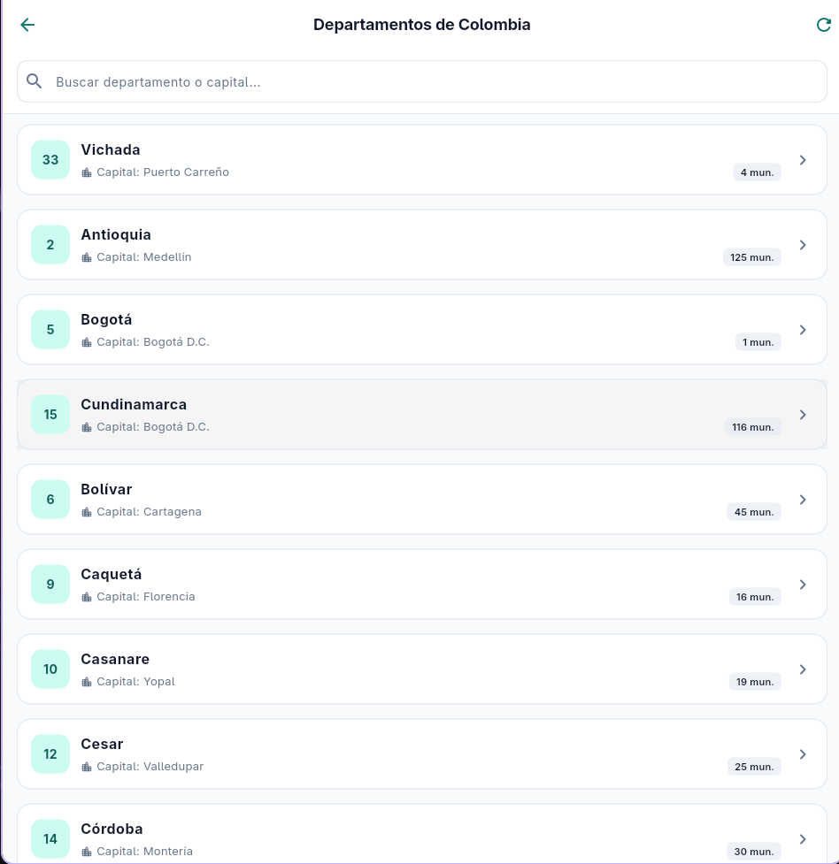
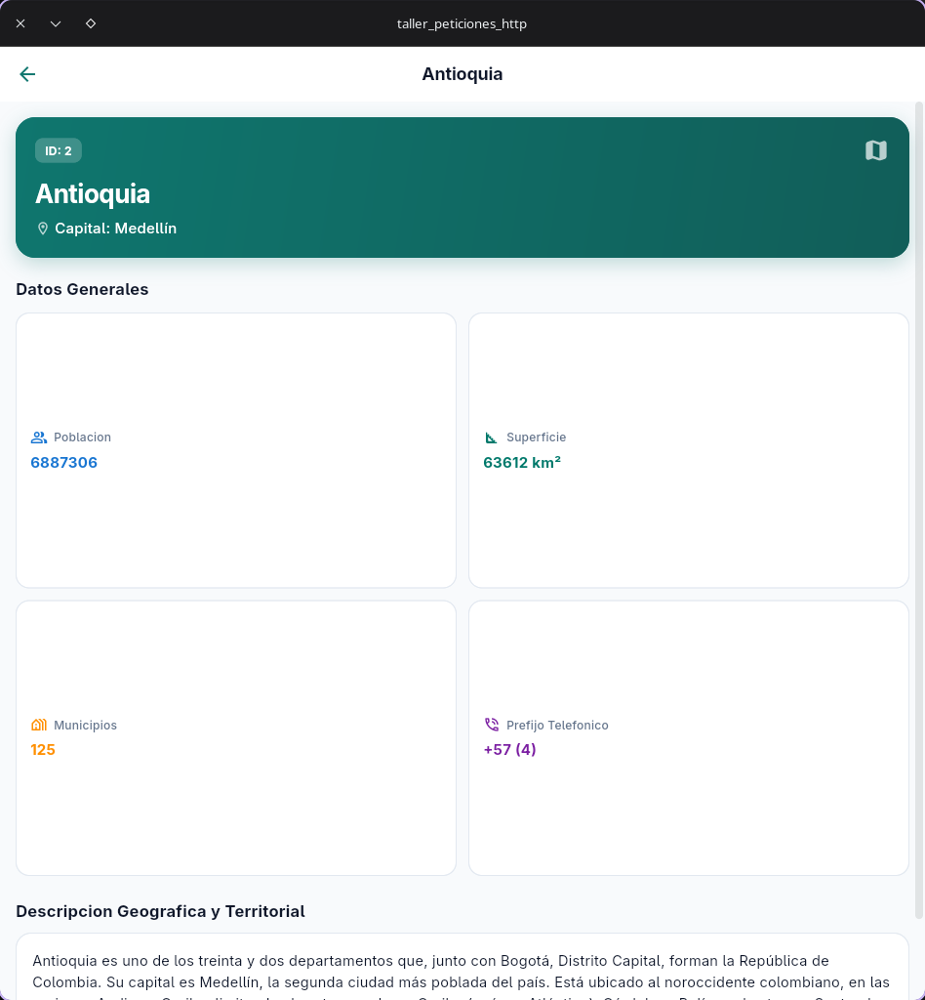
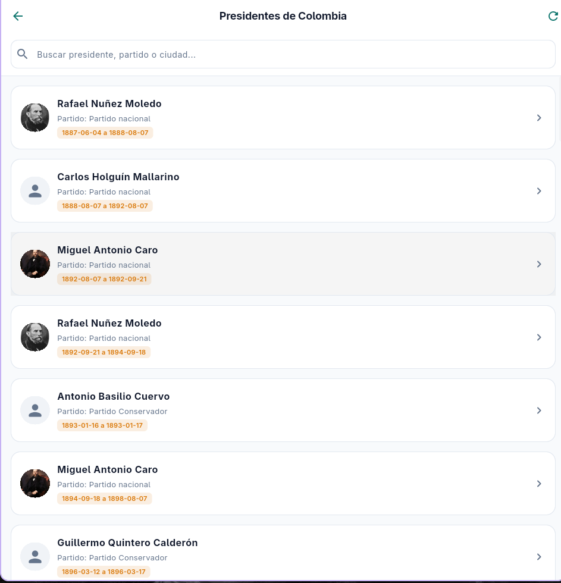
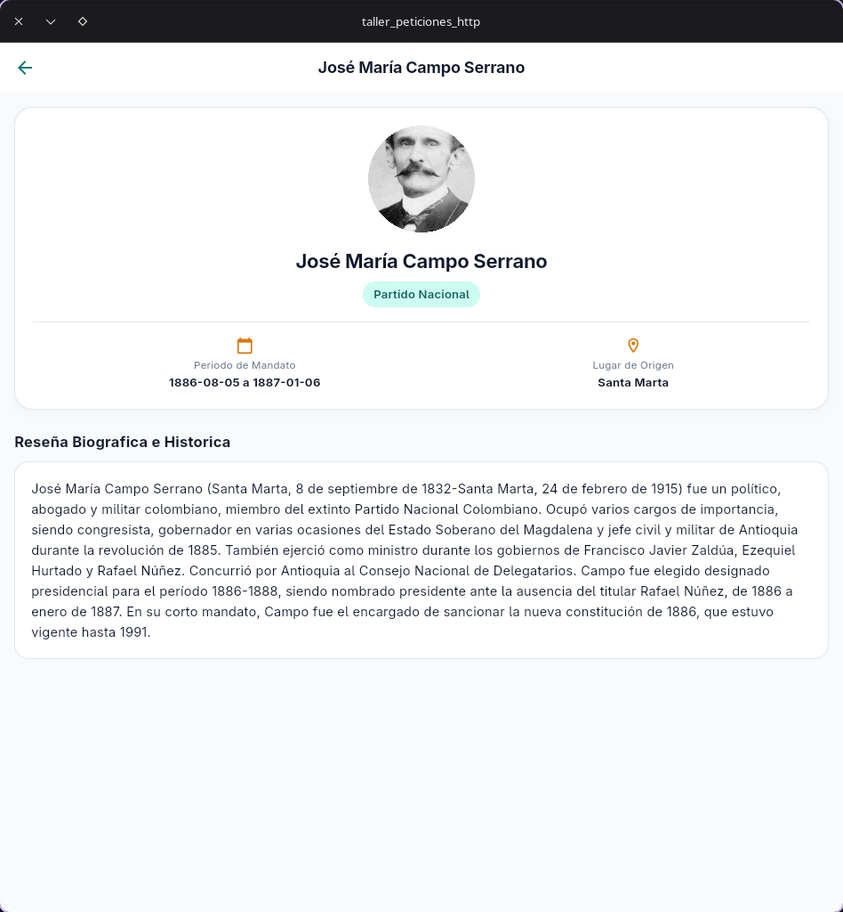
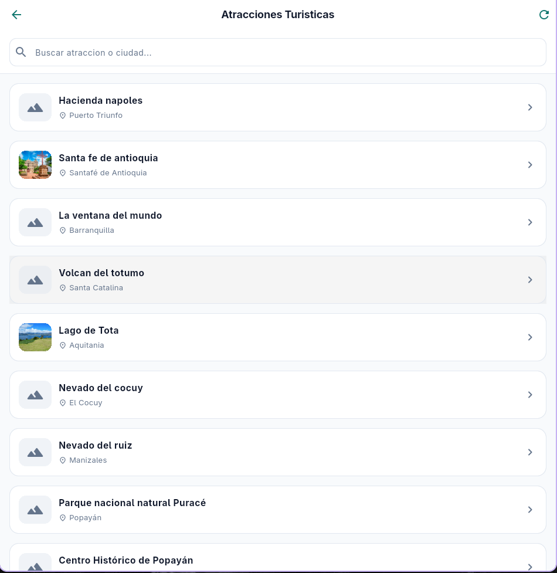
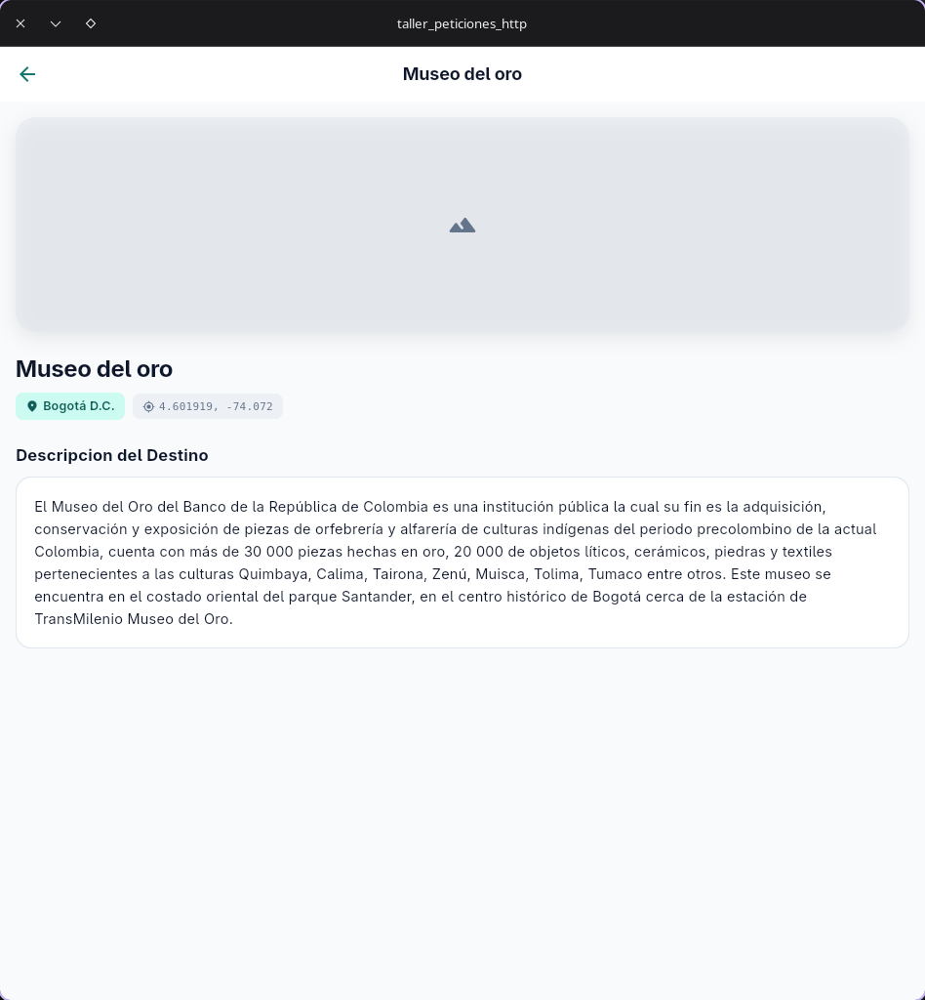
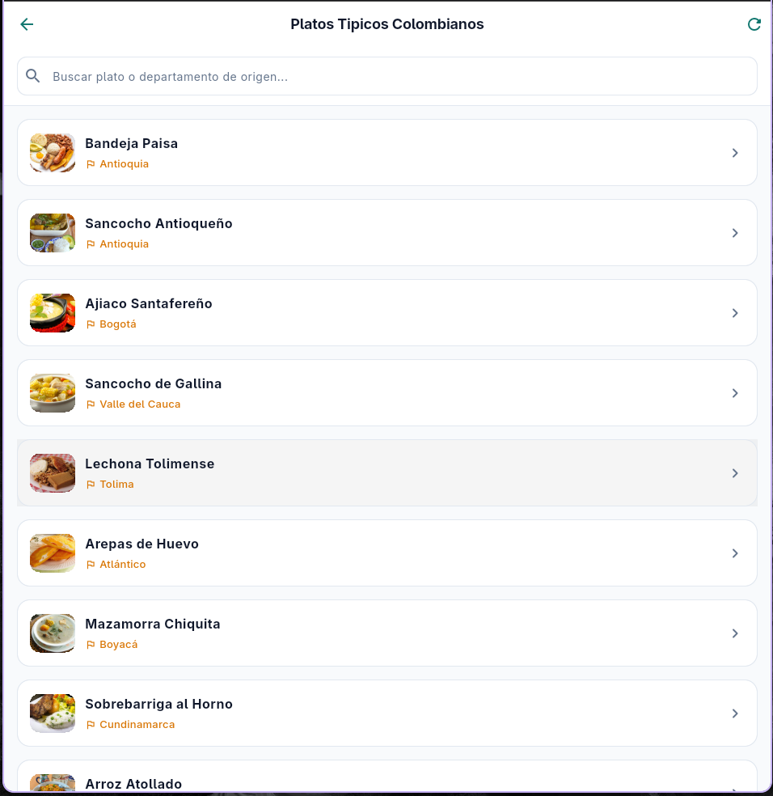
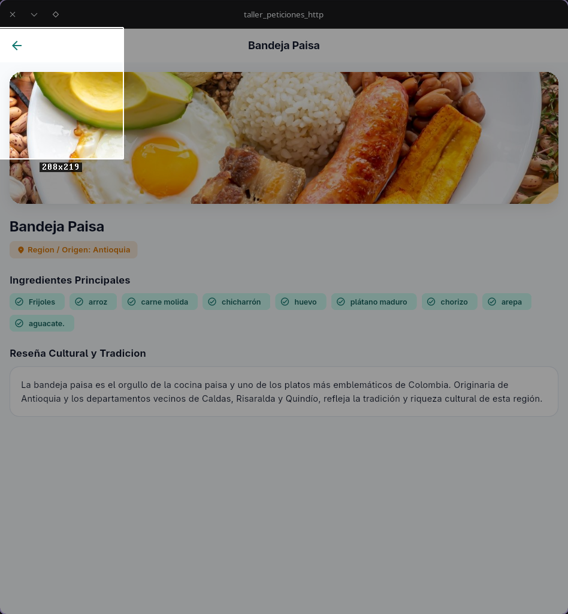

# Datos Abiertos de Colombia - Taller de Peticiones HTTP en Flutter

**Estudiante:** Michael Stiven Vasco Cárdenas  
**Código Estudiantil:** 230231047  
**Asignatura:** Electiva Profesional I  
**Institución:** Unidad Central del Valle del Cauca (UCEVA)  
**Repositorio GitHub:** https://github.com/BreiK-at/Taller_peticionesHTTP  
**Ramas:** `feature/taller_api_colombia` -> `dev` -> `main`  

---

## 1. Descripcion del Proyecto y API Utilizada

Esta aplicacion movil y de escritorio construida en **Flutter** consume los servicios abiertos de la plataforma gubernamental **API Colombia**, permitiendo explorar datos territoriales, historicos, turisticos y gastronomicos del pais.

* **Portal API Colombia:** https://api-colombia.com/
* **Documentacion Swagger:** https://api-colombia.com/swagger/index.html
* **Endpoint Base:** `https://api-colombia.com/api/v1`

### Endpoints Seleccionados:
1. **Departamentos (`/Department`):** Division politica de Colombia, capitales, superficie en km², poblacion censal, municipios y prefijo telefonico nacional.
2. **Presidentes (`/President`):** Registro historico de los mandatarios constitucionales de Colombia, incluyendo filiacion politica, periodos presidenciales, fotografia y resena biografica.
3. **Atracciones Turisticas (`/TouristicAttraction`):** Destinos geograficos, parques naturales y centros de interes con coordenadas de geolocalizacion (latitud y longitud), ciudad y galeria de imagenes.
4. **Platos Tipicos (`/TypicalDish`):** Patrimonio gastronomico tradicional, departamento o region de origen, desglose de ingredientes y fotografias alusivas.

---

## 2. Arquitectura y Estructura del Proyecto

El desarrollo se diseno siguiendo estrictamente una separacion de responsabilidades por capas:

```
lib/
├── config/                  # Configuracion global y carga de variables de entorno (.env)
│   └── app_config.dart
├── models/                  # Modelos tipados con serializacion fromJson y toJson
│   ├── department_model.dart
│   ├── president_model.dart
│   ├── touristic_attraction_model.dart
│   └── typical_dish_model.dart
├── routes/                  # Configuracion y definicion de rutas con go_router
│   └── app_router.dart
├── services/                # Capa de consumo HTTP, control de status codes y excepciones
│   └── api_service.dart
├── themes/                  # Paleta de color, tipografia y estilos Material 3
│   └── app_theme.dart
├── views/                   # Pantallas principales del flujo de navegacion
│   ├── dashboard_view.dart  # Pantalla de inicio con cards introductorias
│   ├── departments/         # Listado y detalle de departamentos
│   │   ├── department_list_view.dart
│   │   └── department_detail_view.dart
│   ├── presidents/          # Listado y detalle de presidentes
│   │   ├── president_list_view.dart
│   │   └── president_detail_view.dart
│   ├── attractions/         # Listado y detalle de sitios turisticos
│   │   ├── attraction_list_view.dart
│   │   └── attraction_detail_view.dart
│   └── dishes/              # Listado y detalle gastronomico
│       ├── dish_list_view.dart
│       └── dish_detail_view.dart
├── widgets/                 # Componentes visuales desacoplados y reutilizables
│   ├── dashboard_card_widget.dart
│   ├── empty_state_widget.dart
│   ├── error_state_widget.dart
│   ├── loading_state_widget.dart
│   └── network_image_with_fallback.dart
└── main.dart                # Inicializacion de Flutter, DotEnv y MaterialApp.router
```

### Paquetes Implementados:
* **`http` (`^1.6.0`):** Peticiones GET asincronas, control de timeouts y decodificacion de bytes UTF-8.
* **`go_router` (`^18.1.1`):** Enrutamiento declarativo con rutas anidadas, paso de parametros por URL (`:id`) y paso de objetos (`extra`).
* **`flutter_dotenv` (`^6.0.1`):** Gestion segura de variables de entorno mediante archivo `.env` registrado en assets.

---

## 3. Rutas Implementadas con go_router

| Ruta | Nombre | Parametros / Extra | Descripcion |
| :--- | :--- | :--- | :--- |
| `/` | `dashboard` | Ninguno | Pantalla de inicio con tarjetas de acceso a cada endpoint y estado de conexion. |
| `/departments` | `departments` | Ninguno | Listado de departamentos con buscador interactivo y pull-to-refresh. |
| `/departments/:id` | `department-detail` | `id` (int), `extra` (`DepartmentModel?`) | Vista de detalle con metricas de poblacion, superficie, capital y descripcion. |
| `/presidents` | `presidents` | Ninguno | Galeria de mandatarios con avatar, partido y periodos de gobierno. |
| `/presidents/:id` | `president-detail` | `id` (int), `extra` (`PresidentModel?`) | Vista de detalle con foto ampliada, ciudad de origen y biografia historica. |
| `/attractions` | `attractions` | Ninguno | Catalogo turistico con miniaturas y ciudad de ubicacion. |
| `/attractions/:id` | `attraction-detail` | `id` (int), `extra` (`TouristicAttractionModel?`) | Detalle con fotografia principal, coordenadas GPS y galeria. |
| `/dishes` | `dishes` | Ninguno | Muestra gastronomica con departamento de origen. |
| `/dishes/:id` | `dish-detail` | `id` (int), `extra` (`TypicalDishModel?`) | Detalle con foto del plato, chips de ingredientes y resena tradicional. |

---

## 4. Ejemplos de Respuestas JSON de la API

### Endpoint: `/Department/2`
```json
{
  "id": 2,
  "name": "Antioquia",
  "description": "Antioquia es uno de los treinta y dos departamentos...",
  "cityCapitalId": 12,
  "municipalities": 125,
  "surface": 63612,
  "population": 6887306,
  "phonePrefix": "4",
  "cityCapital": {
    "name": "Medellin"
  }
}
```

### Endpoint: `/President/1`
```json
{
  "id": 1,
  "image": "https://upload.wikimedia.org/.../Jose_Maria_Campo_Serrano.jpg",
  "name": "Jose Maria",
  "lastName": "Campo Serrano",
  "startPeriodDate": "1886-08-05",
  "endPeriodDate": "1887-01-06",
  "politicalParty": "Partido Nacional",
  "description": "Jose Maria Campo Serrano fue un politico...",
  "city": {
    "name": "Santa Marta"
  }
}
```

### Endpoint: `/TouristicAttraction/1`
```json
{
  "id": 1,
  "name": "Museo del oro",
  "description": "El Museo del Oro del Banco de la Republica...",
  "images": [
    "https://upload.wikimedia.org/.../Museo_del_Oro.JPG"
  ],
  "latitude": "4.601919",
  "longitude": "-74.072",
  "city": {
    "name": "Bogota D.C."
  }
}
```

### Endpoint: `/TypicalDish/1`
```json
{
  "id": 1,
  "name": "Bandeja Paisa",
  "description": "La bandeja paisa es el orgullo de la cocina paisa...",
  "ingredients": "Frijoles, arroz, carne molida, chicharron, huevo, platano maduro, chorizo, arepa, aguacate.",
  "imageUrl": "https://apicolombiastorage.blob.core.windows.net/typicaldishes/1. Bandeja Paisa.jpg",
  "department": {
    "name": "Antioquia"
  }
}
```

---

## 5. Capturas de Pantalla de la Aplicacion

### Dashboard Principal


### Modulo 1: Departamentos de Colombia (Listado y Detalle)
| Listado de Departamentos | Detalle del Departamento (Antioquia) |
| :---: | :---: |
|  |  |

### Modulo 2: Presidentes de Colombia (Listado y Detalle)
| Listado de Presidentes | Detalle del Mandatario |
| :---: | :---: |
|  |  |

### Modulo 3: Atracciones Turisticas (Listado y Detalle)
| Listado de Atracciones | Detalle de Atraccion (Museo del Oro) |
| :---: | :---: |
|  |  |

### Modulo 4: Platos Tipicos (Listado y Detalle)
| Listado Gastronomico | Detalle de Plato (Bandeja Paisa) |
| :---: | :---: |
|  |  |

---

## 6. Flujo GitFlow y Ramas

El repositorio sigue la disciplina de ramas protegidas e integracion continua:

```
[feature/taller_api_colombia] ──(PR #1 Merge)──► [dev] ──(PR #2 Merge)──► [main]
```

1. **`main`:** Rama estable en produccion.
2. **`dev`:** Rama base integradora de desarrollo.
3. **`feature/taller_api_colombia`:** Rama donde se desarrollaron los modelos, servicios, vistas y configuracion.

---

## 7. Instrucciones para Ejecutar el Proyecto

```bash
# 1. Clonar el repositorio
git clone https://github.com/BreiK-at/Taller_peticionesHTTP.git
cd Taller_peticionesHTTP

# 2. Descargar paquetes de dependencias
flutter pub get

# 3. Ejecutar las pruebas unitarias y de widgets
flutter test

# 4. Iniciar la aplicacion (ejemplo en escritorio Linux)
flutter run -d linux
```
